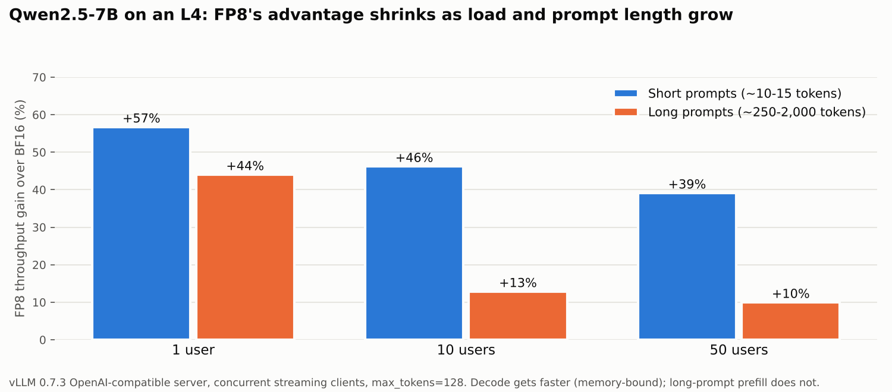

# Qwen2.5-7B-Instruct in FP8: Accuracy, Serving Latency and Cost on an L4

Quantizes **Qwen2.5-7B-Instruct** to **FP8** with llmcompressor (calibration-free `FP8_DYNAMIC`),
checks accuracy with WikiText-2 perplexity, and load-tests BF16 vs FP8 behind **vLLM's
OpenAI-compatible server** with a custom async streaming client (TTFT, inter-token latency, p50/p95/p99,
throughput) at 1, 10 and 50 concurrent users. Throughput is then turned into **cost per million tokens**.

**Headline (NVIDIA L4):** FP8 costs **+1.0% perplexity** (6.469 → 6.536), makes decoding **36% faster per
token** (57.9 → 37.0 ms), and serves short-prompt chat traffic **39% faster / 28% cheaper** at 50 users.
On long, prefill-heavy prompts the gain falls to **10%**, because FP8 speeds up decode (memory-bound)
but not prefill (compute-bound) on this setup.



## Results

L4 24 GB, vLLM 0.7.3, `gpu_memory_utilization=0.85`, `max_model_len=4096`, `max_tokens=128`.

| Measurement | BF16 | FP8 | FP8 vs BF16 |
|---|---:|---:|---:|
| Checkpoint weights | ~15 GB | 8.14 GB | ~46% smaller |
| Perplexity (WikiText-2, 20 × 1,024-token windows) | 6.469 | 6.536 | +1.0% |
| Inter-token latency, 1 user | 57.9 ms | 37.0 ms | 36% faster |
| Short prompts, 50 users: throughput | 434.9 tok/s | 605.1 tok/s | +39% |
| Short prompts, 50 users: cost per 1M output tokens¹ | $0.45 | $0.32 | 28% cheaper |
| Long prompts, 50 users: throughput | 193.7 tok/s | 213.0 tok/s | +10% |
| Long prompts, 50 users: median time to first token | 4.20 s | 1.65 s | 61% faster |
| Offline batch, 240 short prompts | 2,019 tok/s | 2,298 tok/s | +14% |
| KV-cache memory left after loading weights | 3.02 GiB | 8.76 GiB | 2.9× more |

¹ Assumes $0.70/hr for an on-demand L4, output tokens only.

Full per-concurrency tables (TTFT and total-latency percentiles, ITL, per-user throughput, request
rate) are at the end of [`notebooks/02_serve_and_benchmark.ipynb`](notebooks/02_serve_and_benchmark.ipynb)
and in [`docs/report.md`](docs/report.md).

## What the numbers say

- **Decode is memory-bound, and FP8 halves the bytes.** At ~300 GB/s, reading 15 GB of BF16 weights takes
  at least ~51 ms per token; measured ITL was 57.9 ms. FP8's 8.1 GB sets a ~27 ms floor; measured 37.0 ms.
  The rest is KV-cache reads, attention and the BF16 `lm_head`, which FP8 weights do not shrink.
- **Prefill did not get faster.** With ~1,100-token prompts, ~90% of processed tokens are prompt tokens.
  TTFT at 1 and 10 users was slightly *worse* with FP8, so the long-prompt gain is small.
- **Bigger batches dilute the gain.** Short-prompt advantage drops from +57% (1 user) to +39% (50 users)
  to +14% (240-prompt offline batch), because one weight read is shared across more sequences.
- **Smaller weights mean more KV cache, which helps admission.** BF16 left room for ~56.5K cached tokens
  and logged 51 preemptions on the long-prompt batch; FP8 left ~164K. That is why FP8's median TTFT at
  50 long-prompt users is 61% lower even though throughput rose only 10%.

## Engineering notes

- **Calibration-free quantization.** `FP8_DYNAMIC` uses per-channel weight scales and per-token activation
  scales computed at runtime, so no calibration set is needed (contrast: GPTQ in the Phi-2 project).
- **Two isolated environments.** llmcompressor (torch 2.11, transformers 5.x) and vLLM 0.7.3 (torch 2.5,
  transformers 4.x, Python ≤ 3.12) cannot share a runtime.
- **Cross-version checkpoint fixes.** transformers 5 writes a tokenizer field transformers 4 cannot parse
  (patched in notebook 01). A checkpoint that lost its `quantization_config` block silently loaded as
  plain BF16 and then failed on the scale tensors; it was rebuilt from the tensors on disk and verified by
  matching decode speed and perplexity.
- **Stopping the server.** `terminate()` stops only vLLM's API process; the engine process keeps ~18 GB
  of GPU memory. The server is started in its own session and stopped with `os.killpg`.
- **Profiling the right thing.** A `torch.profiler` run through plain transformers showed BF16 GEMM
  kernels: transformers decompresses FP8 checkpoints to BF16. FP8 inference is measured in vLLM.

## Limitations

Each load-test configuration ran once (directional, not statistically tested); prompts are synthetic;
load is closed-loop (fixed users in flight); quality is one metric (perplexity, 20 windows); one GPU
type. Chunked prefill was off (vLLM 0.7.3 default), which is the main reason ITL tripled under
long-prompt load. Details and next steps are in [`docs/report.md`](docs/report.md).

## Repository layout

```
notebooks/
  01_quantize_and_evaluate.ipynb   # session 1: FP8_DYNAMIC quantization, tokenizer patch, perplexity, profile
  02_serve_and_benchmark.ipynb     # session 2: vLLM server, async load test, offline batch, cost model
docs/report.md                     # full write-up with every measurement and the issues found and fixed
assets/                            # figures used in this README
requirements-quantize.txt
requirements-serve.txt
```

## Reproduce

Google Colab with an L4 GPU (FP8 tensor cores; A100 has none). Run notebook 01 in a fresh runtime (it
saves the FP8 checkpoint to Google Drive), then notebook 02 in a new **Python 3.12** runtime. For the
BF16 baseline, start the server with `MODEL_ID` instead of `MODEL_FP8`; set `WORKLOAD = "long"` for the
long-prompt test.

## Tech

vLLM · llmcompressor · compressed-tensors · Hugging Face Transformers · PyTorch · aiohttp / asyncio · torch.profiler

## Related

- [phi2-fp8-quantization-vllm](https://github.com/namrathasanjay/phi2-fp8-quantization-vllm): FP8, GPTQ INT4
  and sensitivity-aware mixed precision for Phi-2 on an H100.
